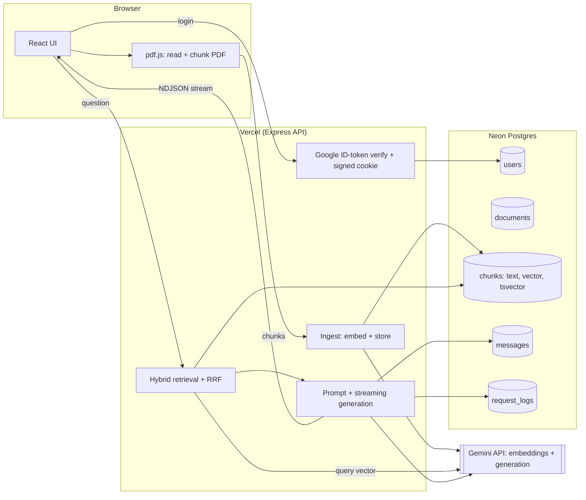

# RAG PDF Chatbot

A multi-user "chat with your PDFs" web app, built like a real product: Google sign-in, saved chat history, streaming answers with page citations, hybrid retrieval, study tools, and an evaluation harness.

**Live demo:** `<paste your Vercel URL here>`

It answers from your PDF first. When the PDF doesn't cover something, it says so ("This isn't covered in your PDF, but here's the answer…") and still explains it properly. Greetings and general questions work like any normal AI chat.

## Features

| | |
|---|---|
| **Google login** | Every user has their own account, documents and chats. Nothing is shared between users. |
| **Saved history** | Reopen any previous PDF and conversation after a refresh, on any device. |
| **Streaming answers** | Tokens appear as they are generated. |
| **Citations + highlighting** | Answers cite `[Source Block #n]` → clickable chips showing the page and the matching passage with the search words highlighted. Only passages the answer actually used are shown. |
| **Hybrid retrieval** | pgvector semantic search + Postgres full-text search, fused with Reciprocal Rank Fusion. Optional LLM reranking. |
| **Multi-PDF chat** | "All documents" chat searches across every PDF you uploaded. |
| **Study tools** | Summarize, Quiz me, Flashcards (also triggered by typing e.g. "quiz me on unit 2"). |
| **Normal chatbot too** | "hi", general questions and follow-ups work. Conversation memory = last 10 messages. |
| **Observability** | Latency, time-to-first-token, retrieval time, token counts and errors logged per request; `/api/metrics` summary for admins. |
| **Evaluation** | `npm run eval` measures retrieval (Hit@k, MRR) and answer accuracy on a generated test set. |
| **Abuse protection** | Per-user daily message limit, document cap, upload size/chunk limits (friends share your Gemini key). |

## Architecture



**Request flow for a question:** embed the question → vector search and keyword search run in parallel in Postgres → fuse with RRF (→ optional rerank) → build a prompt with numbered Source Blocks + last 10 messages → stream the Gemini answer to the browser → save the exchange → log metrics.

### Design decisions (good interview material)

- **Hybrid retrieval beats plain similarity.** Embeddings capture meaning but blur exact tokens: names, acronyms, "week 12", numbers. Full-text search nails exact terms but misses paraphrases. Reciprocal Rank Fusion merges both rankings without having to compare their incompatible scores. `npm run eval` prints the comparison on your own PDF.
- **PDF parsing in the browser.** Avoids Vercel's 4.5 MB request limit and keeps the server stateless. Only small chunk batches are sent to the API.
- **pgvector in the same database as everything else.** One store for users, chats and vectors. All queries are filtered by `user_id`, so users can never see each other's data.
- **Grounded but not trapped.** One prompt handles greetings, PDF answers (with citations), "related but not in the PDF" answers and unrelated questions. Retrieval is skipped for small talk.
- **Streaming protocol.** NDJSON events: `meta` (sources) → `delta` (tokens) → `done` (which sources were cited, token usage). Errors before the first token return a normal JSON error; errors mid-stream arrive as an `error` event.
- **Auth without a framework.** The browser gets a Google ID token (Sign in with Google), the server verifies it against Google's public keys (`jose`), then issues its own signed, httpOnly, 30-day session cookie.

## Setup

### 1. Neon Postgres (free)
In your Vercel project: **Storage → Create → Neon** (or create a project at neon.tech). Vercel adds `DATABASE_URL` for you. Tables and the `pgvector` extension are created automatically on the first request, so there is no SQL to run.

### 2. Google sign-in (free)
1. [Google Cloud Console](https://console.cloud.google.com) → create a project → **APIs & Services → OAuth consent screen** (External, add your email as a test user, then publish the app when you want friends to log in).
2. **Credentials → Create credentials → OAuth client ID → Web application**.
3. **Authorized JavaScript origins**: `https://YOUR-APP.vercel.app` and `http://localhost:3000`. (No redirect URI needed.)
4. Copy the **Client ID**.

### 3. Environment variables
In Vercel: **Project Settings → Environment Variables** (then redeploy). Locally: copy `.env.example` to `.env`.

| Variable | Required | Notes |
|---|---|---|
| `GEMINI_API_KEY` | yes | https://aistudio.google.com/apikey |
| `DATABASE_URL` | yes | Neon connection string |
| `GOOGLE_CLIENT_ID` | yes | From step 2 |
| `AUTH_SECRET` | yes | Random 32+ chars: `node -e "console.log(require('crypto').randomBytes(32).toString('hex'))"` |
| `ADMIN_EMAILS` | no | Comma-separated emails allowed to open `/api/metrics` |
| `DAILY_MESSAGE_LIMIT` | no | Default 60 per user per 24h |
| `MAX_DOCS_PER_USER` | no | Default 15 |
| `ENABLE_RERANK` | no | `true` adds an LLM rerank step |
| `GEMINI_MODEL`, `GEMINI_EMBEDDING_MODEL`, `GEMINI_EMBEDDING_DIMENSIONS` | no | Defaults: `gemini-2.5-flash`, `gemini-embedding-001`, `768` |

### 4. Run locally
```bash
npm install
cp .env.example .env     # fill it in
npm run dev              # http://localhost:3000
npm test                 # unit tests
npm run lint             # type check
```

### 5. Deploy
Push to GitHub; Vercel builds automatically (`vite build`; the API is `api/[[...slug]].ts`).

> Google sign-in does not work inside in-app browsers (WhatsApp, Instagram). Friends should open the link in Chrome or Safari.

## Evaluation

```bash
npm run eval -- --pdf ./samples/my-notes.pdf --questions 20 --k 5
# add --rerank to also test LLM reranking
```
It indexes the PDF under a throwaway user, has Gemini write 20 questions from known chunks (saved to `eval/dataset.json`, so you can edit it), then reports **Hit@k, page Hit@k and MRR** for vector-only vs keyword-only vs hybrid, plus **LLM-judged answer accuracy** and citation rate. Output: `eval/report.md`.

### Results

Run the command above on your own PDF and paste the table from `eval/report.md` here:

| Strategy | Hit@5 (chunk) | Hit@5 (page) | MRR |
|---|---|---|---|
| vector only | | | |
| keyword only | | | |
| hybrid (RRF) | | | |

Answer accuracy (LLM judge): `_` · Citation rate: `_` · p50 latency: `_` ms (from `/api/metrics`)

## Observability

Every chat request writes one structured JSON log line (visible in Vercel → Logs) and a row in `request_logs`: status, total latency, retrieval time, time-to-first-token, prompt/output tokens, error text. Admins (`ADMIN_EMAILS`) can open `/api/metrics` for p50/p95 latency, time-to-first-token, error rate, token totals and user/document counts over the last 7 days.

## Project layout

```
api/[[...slug]].ts      Vercel entry (exports the Express app)
server.ts               Local dev server (Vite + API)
src/ragApp.ts           All HTTP routes
src/server/             auth, db + schema, retrieval, ingest, prompts, gemini, logging, pure helpers
src/lib/                browser-side PDF reading, chunking, API client, stream parser
src/components/         UI components
src/AuthGate.tsx        Login gate
scripts/eval.ts         Evaluation harness
tests/                  Unit tests (retrieval fusion, parsing, modes, cookies, streaming)
```

## Database

`users`, `documents`, `chunks (text, embedding vector(768), tsvector)`, `messages (sources, cited, terms as jsonb)`, `request_logs`. Created automatically by `src/server/db.ts`.

## Limitations / ideas

- Scanned (image-only) PDFs need OCR; not supported yet.
- One conversation per document (plus General and All documents). Multiple named threads per document would be a natural next step.
- Vector search scans a user's own chunks (fast at this scale). Add an HNSW index if a single user stores tens of thousands of chunks.
